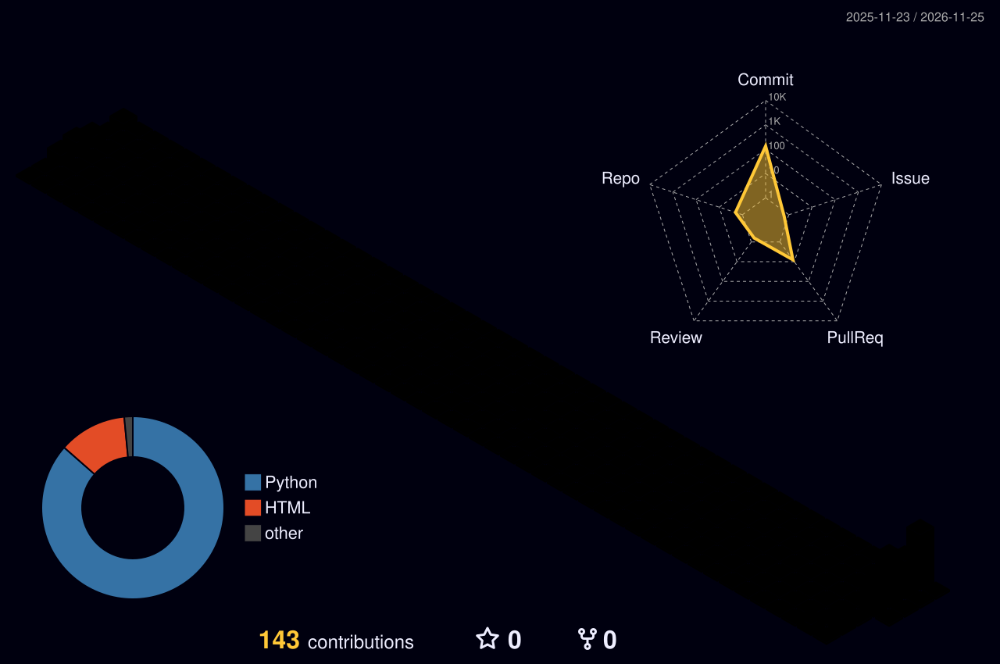

<!-- Cabeçalho -->
<p align="center">
  
</p>

<p align="center">
  <a href="https://github.com/W3LLCR0S">
    
  </a>
</p>

<p align="center">
  
  <a href="https://www.linkedin.com/in/samuel-paulo-valero-de-souza-9b328122a"></a>
  <a href="mailto:samuel.pv.souza@gmail.com"></a>
</p>

---

## 👨‍💻 Sobre mim

Sou estudante de **Engenharia de Software no SENAI Londrina** e desenvolvo aplicações **full stack web e mobile**, do banco de dados à interface. Hoje trabalho como **Técnico de Suporte N1 na Semantix**, onde automatizo atendimentos com scripts em PowerShell.

- 🎓 Cursando o 6º período de Engenharia de Software
- 🏆 Participei do **Smart Cities Hackathon 2026** com o projeto **Prevora**
- 🤖 Uso IA generativa no meu fluxo de desenvolvimento
- 🎯 Buscando estágio em **desenvolvimento de software e IA**
- 📍 Londrina, PR — Brasil

```js
const samuel = {
  role: "Desenvolvedor Full Stack",
  estudando: "Engenharia de Software @ SENAI Londrina",
  trabalhando: "Técnico de Suporte N1 @ Semantix",

  linguagens: ["JavaScript", "TypeScript", "Python", "Java", "C#", "Dart", "SQL"],

  frontend: ["React", "Next.js", "Tailwind CSS"],
  mobile: ["React Native", "Expo", "Flutter"],
  backend: ["Node.js", "Express", "FastAPI", "Flask", "Spring Boot", ".NET"],
  bancoDeDados: ["MySQL", "PostgreSQL", "Oracle", "Supabase"],

  ferramentas: ["Git", "PowerShell", "Claude Code", "Vercel", "Jupyter"],
  aprendendoAgora: ["IA aplicada", "Agentes de IA", "APIs com FastAPI"],
};
```

---

## 🛠️ Tech Stack

<p align="center">
  <br/><br/>
  <br/><br/>
  
</p>

---

## 🚀 Projetos em destaque

| Projeto | Descrição | Tecnologias |
| --- | --- | --- |
| **Prevora** | Smart Cities Hackathon 2026 — plataforma para servidores públicos que mapeia descarte irregular e prevê coletas de lixo e alagamentos | Next.js, FastAPI, Leaflet, Vercel |
| [**Sistema de Gestão de Manutenção**](https://github.com/W3LLCR0S/sistema-gestao-manutencao) | Ciclo de vida da manutenção de equipamentos: abertura de OS, diagnóstico, reparo, aprovação e histórico | FastAPI, SQLAlchemy, PostgreSQL, React, TypeScript |
| **Catálogo de Obras — Vectra** | Jornada de Aprendizagem SENAI — sistema web para catalogar e criar obras, com orçamentos e materiais usados em cada obra | React, MySQL |
| [**TeamSwap**](https://github.com/W3LLCR0S/teamSwap) | App para colaboradores de plantas diferentes demonstrarem interesse e trocarem de planta entre si | Java, Spring Boot, HTML, CSS, JavaScript |
| **Jornada Ademicon** | App mobile de CRM com busca de leads, visitas, vendas e painel do gestor | Flutter, Flask, Oracle |
| **Sistema Acadêmico** | API REST com CRUD completo e documentação | Node.js, Express, MySQL |
| [**dash_of_CPV**](https://github.com/W3LLCR0S/dash_of_CPV) | Dashboard desenvolvido para a empresa CPV | HTML |

---

## 📊 GitHub Stats

<p align="center">
  
  
</p>

<p align="center">
  
</p>

<p align="center">
  
</p>

<p align="center">
  
</p>

<p align="center">
  <picture>
    <source media="(prefers-color-scheme: dark)" srcset="https://raw.githubusercontent.com/W3LLCR0S/W3LLCR0S/output/github-contribution-grid-snake-dark.svg" />
    
  </picture>
</p>

---

## 📫 Vamos conversar?

<p align="center">
  <a href="https://www.linkedin.com/in/samuel-paulo-valero-de-souza-9b328122a"></a>
  <a href="mailto:samuel.pv.souza@gmail.com"></a>
</p>

<p align="center">
  
</p>
